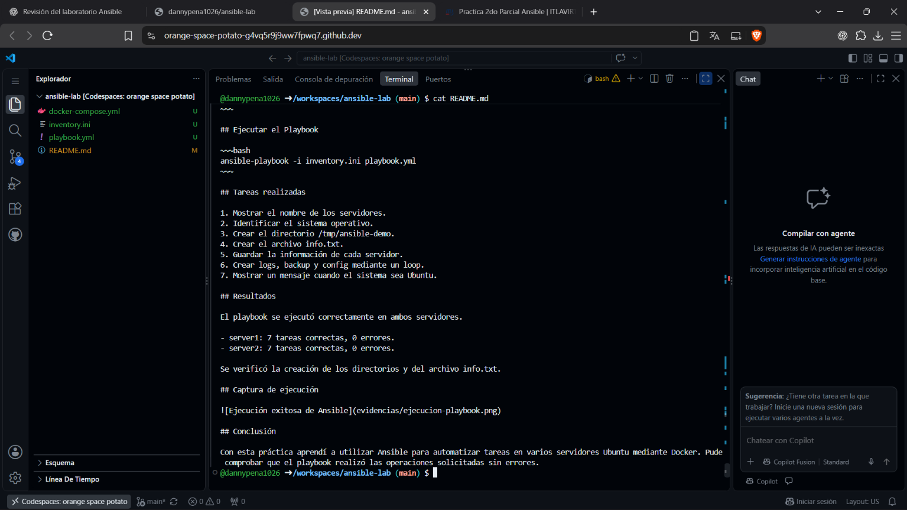

# Laboratorio Ansible con Docker

**Estudiante:** Danny Peña Adames  
**Matrícula:** 2025-1124  
**Materia:** Programación Paralela  
**Profesor:** Wilmer Fariña

## Objetivo

Aprender a utilizar Ansible para automatizar tareas en dos servidores Ubuntu 24.04 creados mediante Docker, trabajando desde GitHub Codespaces.

## Herramientas utilizadas

- GitHub Codespaces
- Docker y Docker Compose
- Ansible
- Ubuntu 24.04
- Python 3

## Iniciar los contenedores

~~~bash
docker compose up -d
docker ps
~~~

## Instalar Python

~~~bash
docker exec server1 bash -c "apt update && apt install -y python3"
docker exec server2 bash -c "apt update && apt install -y python3"
~~~

## Comprobar la conexión

~~~bash
ansible-galaxy collection install community.docker
ansible docker -i inventory.ini -m ping
~~~

## Ejecutar el Playbook

~~~bash
ansible-playbook -i inventory.ini playbook.yml
~~~

## Tareas realizadas

1. Mostrar el nombre de los servidores.
2. Identificar el sistema operativo.
3. Crear el directorio /tmp/ansible-demo.
4. Crear el archivo info.txt.
5. Guardar la información de cada servidor.
6. Crear logs, backup y config mediante un loop.
7. Mostrar un mensaje cuando el sistema sea Ubuntu.

## Resultados

El playbook se ejecutó correctamente en ambos servidores.

- server1: 7 tareas correctas, 0 errores.
- server2: 7 tareas correctas, 0 errores.

Se verificó la creación de los directorios y del archivo info.txt.

## Captura de ejecución

## Conclusión

Con esta práctica aprendí a utilizar Ansible para automatizar tareas en varios servidores Ubuntu mediante Docker. Pude comprobar que el playbook realizó las operaciones solicitadas sin errores.
